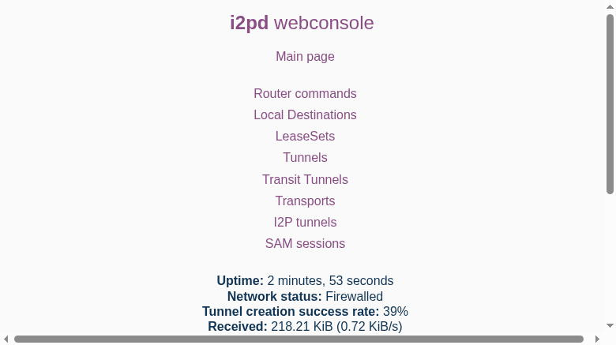

<!--
N.B.: This README follows the layout of the YunoHost readme generator
(https://github.com/YunoHost/apps_tools/blob/main/readme_generator)
so it can be regenerated from the manifest later without rework.
-->

<h1>
  
  i2pd, packaged for YunoHost
</h1>

Lightweight C++ router for the I2P anonymous network

[i2pd](https://i2pd.website) is a full-featured I2P router written in C++ — a lighter alternative to the Java router. It relays encrypted tunnels for the network (by default volunteering as a **floodfill**) and gives the server local access points to I2P: an HTTP and a SOCKS proxy for eepsites, plus a SAM bridge for applications and containers. The webconsole (peers, tunnels, bandwidth, addressbook) is proxied by nginx behind the YunoHost SSO portal.

**Sharing capacity:** floodfill mode answers the network's distributed-database queries for everyone — the main way to contribute capacity to I2P. Disable it with `floodfill = false` in `/etc/i2pd/i2pd.conf` for a plain relay. Forward the peer port (default **4567, TCP and UDP**) on your internet router so the router reaches "OK" instead of "Firewalled".

**Side by side with the Java router:** this app and `java_i2p` can run at the same time — webconsole and peer ports never clash — but both inherit the same upstream proxy/SAM defaults (4444 / 7656). When installing i2pd on a server that already runs `java_i2p`, choose different ports when asked (e.g. 4447, 4448, 7666); the installation fails fast on an occupied port. See the table below.

[](https://i2pd.website)


<div align="center">
<a href="https://github.com/quartztester/i2pd_ynh#readme"></a>
<a href="https://github.com/quartztester/i2pd_ynh/issues"></a>
</div>

## Ports when both routers run

All loopback unless noted. The right-hand column is the `java_i2p` app's fresh-install defaults.

| Service | i2pd | java_i2p |
|---|---|---|
| Webconsole (nginx + SSO) | 7070 | 7657 |
| I2NP peer port (TCP+UDP, firewalled open) | 4567 | 51427 |
| HTTP proxy | 4444 → pick e.g. 4447 | 4444 |
| HTTPS/CONNECT proxy | — | 4445 |
| SOCKS proxy | 4447 → pick e.g. 4448 | — |
| SAM bridge | 7656 → pick e.g. 7666 | 7656 |
| IRC / SMTP / POP client tunnels | — | 6668 / 7659 / 7660 |
| Eepsite Jetty | — | 7658 |
| I2CP | 7654 (disabled by default) | 7654 |

## Screenshots



## 📦 Developer info

🛠️ Upstream i2pd repository: <https://github.com/PurpleI2P/i2pd>

The app installs upstream's official release `.deb` for your architecture (sha256-pinned in `scripts/_common.sh`; the upstream apt repository is bypassed). The deb brings its own systemd unit, `i2pd` user and AppArmor profile — the package keeps all of the deb's native paths (`/etc/i2pd`, `/var/lib/i2pd`).

Pull requests are welcome against the `main` branch; install the development state directly with:
```
# fresh install:
sudo yunohost app install https://github.com/quartztester/i2pd_ynh

# upgrade an existing install:
sudo yunohost app upgrade i2pd -u https://github.com/quartztester/i2pd_ynh
```

### 📚 App packaging documentation

Please see <https://doc.yunohost.org/dev/packaging/> for more information.
